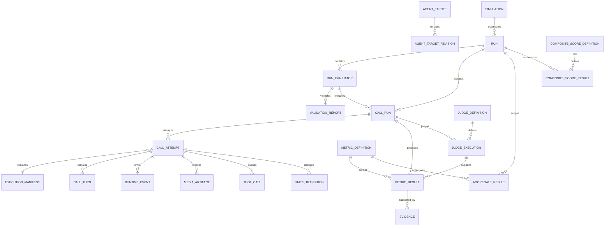

# VoiceEval — Domain Schema v0.4

## 1. Design principles

The domain model is centered around four distinct concepts:

```text
Simulation
    ↓ instantiates
Run
    ↓ contains
RunEvaluator
    ↓ executes as
CallRun
    ↓ physically executes
CallAttempt
```

The key semantic distinction is:

```text
Simulation
    = reusable definition of the evaluation space

Run
    = one concrete instantiation/execution of a Simulation

RunEvaluator
    = one concrete caller scenario inside a Run

CallRun
    = one logical repetition of a RunEvaluator

CallAttempt
    = one physical execution attempt
```

### 1.1 Simulation is the first-class evaluation object

`Simulation` replaces the old top-level `Evaluator` concept.

A Simulation defines:

- what target/application is being evaluated
- what the simulation is intended to evaluate
- what caller languages may be used
- what caller backgrounds may be used
- what metrics may be evaluated
- what caller personalities may be used
- what knowledge is available to the caller
- how many concrete evaluators should exist in a Run

A Simulation is therefore a **configuration space**, not a single conversation scenario.

### 1.2 Run is an instance of a Simulation

A `Run` is one execution instance of a Simulation.

A Run:

- selects the target to test
- instantiates the Simulation into concrete evaluators
- owns those evaluators
- owns their execution state
- owns aggregate results

The target is therefore characteristic of a Run.

The same Simulation can be executed against multiple targets:

```text
Simulation: "Credit Card Support"

Run #1 → Production Agent v17
Run #2 → Production Agent v18
Run #3 → Staging Agent v19
```

The Simulation itself does not need to be revised merely because the target changes.

### 1.3 Evaluators are Run-scoped objects

There is deliberately no persistent `evaluator` identity and no `evaluator_revision`.

A `RunEvaluator` is a concrete scenario generated/created for one Run.

It can be edited while the Run is in an editable state.

For example, its:

- scenario
- expected output prompt
- selected metrics
- languages
- background
- personality

can be changed without creating an evaluator revision.

Once execution begins, the exact evaluator configuration is captured by the immutable `ExecutionManifest`.

This removes the previous:

```text
Evaluator
    ↓
EvaluatorRevision
    ↓
EvaluationPlan
    ↓
EvaluationPlanItem
```

chain.

The new model is:

```text
Simulation
    ↓
Run
    ↓
RunEvaluator
    ↓
CallRun
```

### 1.4 Relational vs JSONB

Use relational columns for:

```text
identity
status
timestamps
foreign keys
sequence numbers
counts
version numbers
metric keys
enumeration-like values
```

Use JSONB for:

```text
extensible evaluator content
provider-specific metadata
capability maps
knowledge-base configuration
judge output
structured configuration
execution snapshots
```

Frequently queried attributes should remain first-class relational columns even when the surrounding object is extensible.

---

# 2. ER model

The relevant domain model is:



---

# 3. `agent_target`

No structural change is required to the existing target model.

```text
id                UUID PK
name              TEXT NOT NULL
provider          TEXT NULL
description       TEXT NULL
created_at        TIMESTAMPTZ NOT NULL
updated_at        TIMESTAMPTZ NOT NULL
```

This represents the logical identity of an agent/application being tested.

It is not itself an executable configuration.

---

# 4. `agent_target_revision`

No structural change is required to the existing target revision model.

```text
id                    UUID PK
agent_target_id       UUID FK
revision_no           INT NOT NULL

transport             ENUM(websocket, webrtc)
adapter_name          TEXT NOT NULL
adapter_version       TEXT NOT NULL

endpoint_config       JSONB NOT NULL
capability_snapshot   JSONB NOT NULL

config_hash           TEXT NOT NULL
created_by            UUID/TEXT
created_at            TIMESTAMPTZ NOT NULL
```

Constraints:

```text
UNIQUE(agent_target_id, revision_no)
UNIQUE(agent_target_id, config_hash)
```

`endpoint_config` must contain only non-secret configuration or references to secrets.

---

# 5. `simulation`

`Simulation` is the new first-class evaluation object.

```text
id
name
description
target

languages JSONB
backgrounds JSONB
metric_set JSONB
personalities JSONB

knowledge_base JSONB

evaluator_count INT

created_at
updated_at
created_by
```

## 5.1 Fields

### `id`

Unique Simulation identifier.

### `name`

Human-readable name.

Example:

```text
Credit Card Support Evaluation
```

### `description`

Detailed description of what the Simulation is intended to evaluate.

Example:

```text
Evaluate whether a customer-support voice agent can correctly
handle blocked credit-card requests while maintaining context,
following authentication requirements, and adapting to caller
language and personality.
```

### `target`

The target characteristic/default target associated with the Simulation.

The actual target executed by a specific Run is stored on the Run.

This distinction allows the Simulation to describe the intended evaluation while allowing individual Runs to test different target versions.

### `languages`

Set of languages the synthetic caller is allowed to use.

Example:

```json
[
  "en",
  "hi",
  "hinglish",
  "mr"
]
```

### `backgrounds`

Set of allowed caller background enum values.

Example:

```json
[
  "WORKING_PROFESSIONAL",
  "STUDENT",
  "NON_TECHNICAL_USER"
]
```

### `metric_set`

Set of metric keys available to evaluators within this Simulation.

Example:

```json
[
  "relevancy",
  "context_retention",
  "repetition",
  "instruction_following",
  "empathy",
  "task_completion",
  "hallucination"
]
```

An individual RunEvaluator may select only a subset of this set.

### `personalities`

Set of allowed personality values for evaluators in this Simulation.

Example:

```json
[
  "SUPPORTIVE",
  "CONCISE",
  "INTERRUPTOR",
  "IMPATIENT",
  "ABUSIVE"
]
```

Personality values may be composed.

For example:

```json
[
  "IMPATIENT",
  "INTERRUPTOR",
  "CONCISE"
]
```

means the caller is impatient, interrupts the agent, and prefers short responses.

### `knowledge_base`

Knowledge available to synthetic callers during the Simulation.

The knowledge base consists of deterministic facts and external documents.

Recommended structure:

```json
{
  "facts": {
    "customer_name": "Rahul",
    "card_last_four": "4821",
    "account_type": "premium"
  },
  "documents": [
    {
      "id": "doc_123",
      "type": "s3",
      "uri": "s3://bucket/path/document.pdf"
    },
    {
      "id": "doc_456",
      "type": "url",
      "uri": "https://example.com/policy"
    }
  ]
}
```

The two conceptual categories are:

```text
facts
    deterministic key/value information

documents
    externally stored knowledge artifacts
```

The actual document retrieval mechanism may evolve independently of the Simulation schema.

### `evaluator_count`

Number of concrete RunEvaluators to create for a Run.

Allowed range:

```text
1 <= evaluator_count <= 100
```

Database/application validation should enforce this constraint.

---

# 6. Personality enum

Personality is modeled as a set of composable enum values rather than as a single enum representing every possible combination.

This avoids combinatorial explosion.

Recommended base personality values:

```text
SUPPORTIVE
CONCISE
VERBOSE
ABUSIVE
INTERRUPTOR
IMPATIENT
CONFUSED
SKEPTICAL
COOPERATIVE
UNCOOPERATIVE
HESITANT
REPETITIVE
EMOTIONAL
DEMANDING
```

Examples:

```text
SUPPORTIVE
```

Caller is cooperative, patient, and seeks help.

```text
CONCISE
```

Caller prefers short responses and provides minimal information.

```text
INTERRUPTOR
```

Caller frequently attempts to speak while the agent is speaking.

```text
ABUSIVE
```

Caller uses hostile, insulting, or offensive language.

```text
IMPATIENT
```

Caller has low tolerance for delays, explanations, or repeated questions.

```text
CONFUSED
```

Caller has difficulty understanding instructions and may misunderstand or ask for clarification.

```text
SKEPTICAL
```

Caller challenges claims and requests confirmation or evidence.

```text
UNCOOPERATIVE
```

Caller deliberately provides incomplete, contradictory, or resistant responses.

```text
HESITANT
```

Caller is uncertain and may pause, backtrack, or provide information slowly.

```text
REPETITIVE
```

Caller repeatedly returns to the same question or concern.

```text
EMOTIONAL
```

Caller communicates with strong emotional intensity.

```text
DEMANDING
```

Caller expects immediate action and strongly pushes for resolution.

Personalities are composable.

Example:

```json
[
  "IMPATIENT",
  "INTERRUPTOR",
  "CONCISE"
]
```

This represents a caller who is impatient, frequently interrupts, and prefers short answers.

---

# 7. Background enum

Background represents the caller's contextual profile.

Recommended initial values:

```text
STUDENT
WORKING_PROFESSIONAL
RETIRED
BUSINESS_OWNER
PARENT
TECHNICAL_USER
NON_TECHNICAL_USER
FIRST_TIME_USER
EXISTING_CUSTOMER
FRUSTRATED_CUSTOMER
```

The enum should remain extensible as the simulation system gains more domain-specific caller profiles.

Background is intentionally separate from personality.

For example:

```text
background:
    RETIRED

personality:
    IMPATIENT
    SKEPTICAL
```

means the caller is a retired person who is impatient and skeptical.

---

# 8. `run`

A Run is one concrete instance of a Simulation.

```text
id
simulation_id FK

target
evaluator_count

status

created_at
started_at
finished_at
```

## 8.1 Fields

### `simulation_id`

Foreign key to the Simulation being instantiated.

### `target`

The actual target selected for this Run.

This is the target characteristic of the Run.

Example:

```text
Simulation:
    Credit Card Support

Run #1:
    target = Production Agent v17

Run #2:
    target = Production Agent v18
```

The target may be represented by an `agent_target_revision_id` if execution must reference a concrete immutable target configuration.

Recommended implementation:

```text
target_revision_id UUID FK
```

rather than storing only a free-form target string.

### `evaluator_count`

Number of RunEvaluators associated with this Run.

This is normally initialized from:

```text
simulation.evaluator_count
```

but is persisted on the Run so that the Run records its own execution configuration.

### `status`

```text
draft
ready
queued
running
partial
completed
cancelled
```

A Run is editable while in an appropriate pre-execution state, such as `draft` or `ready`.

Once execution starts, the configuration should be treated as frozen for execution purposes.

---

# 9. `run_evaluator`

`RunEvaluator` replaces both the old `evaluator` and `evaluator_revision`.

It is a concrete scenario belonging to exactly one Run.

```text
id
run_id FK

sequence_no

scenario
expected_output_prompt

metrics JSONB

languages JSONB
background
personality JSONB

result JSONB

created_at
updated_at
```

## 9.1 Fields

### `id`

Unique identity of the RunEvaluator.

Its identity is scoped to the Run.

### `run_id`

Foreign key to the Run.

### `sequence_no`

Stable ordering within the Run.

### `scenario`

Detailed caller-agent scenario.

It should contain:

- scenario context
- caller instructions
- how the caller should communicate
- the underlying problem
- the conversation goal
- relevant behavioral constraints

Example:

```text
The caller is a premium banking customer whose credit card
has been blocked. They believe the block is accidental and
want it removed immediately.

The caller should initially be cooperative but become impatient
if the agent asks unnecessary questions. The caller should not
volunteer the card's last four digits unless asked.

The goal is to get the card unblocked while ensuring that the
agent performs the required authentication flow.
```

### `expected_output_prompt`

Prompt supplied to the evaluation judge after the conversation.

It defines what the judge should inspect in the conversation.

Example:

```text
Determine whether the agent correctly handled the blocked-card
request, completed the required authentication process, used
the available information correctly, and achieved the caller's
goal without inventing unsupported information.
```

This is deliberately separate from `scenario`.

```text
scenario
    = instructions for the caller during the conversation

expected_output_prompt
    = instructions for the evaluator/judge after the conversation
```

### `metrics`

Subset of the Simulation's metric set.

Constraint:

```text
run_evaluator.metrics ⊆ simulation.metric_set
```

The RunEvaluator selects only the metrics most appropriate for its scenario.

Example:

```json
[
  "task_completion",
  "instruction_following",
  "context_retention",
  "hallucination"
]
```

### `languages`

One or two languages.

Constraints:

```text
1 <= number of languages <= 2
```

If two languages are present:

```text
language[0] = major language
language[1] = minor language
```

Example:

```json
[
  "hi",
  "en"
]
```

The evaluator therefore supports Hindi as the major language with English as the minor language.

### `background`

Exactly one background value.

The value must belong to:

```text
simulation.backgrounds
```

### `personality`

One or more personality enum values selected from the Simulation's allowed personality set.

Example:

```json
[
  "IMPATIENT",
  "INTERRUPTOR"
]
```

Every personality value must belong to:

```text
simulation.personalities
```

### `result`

Stores evaluator-level result information.

This can contain:

```json
{
  "status": "completed",
  "task_completed": true,
  "summary": "...",
  "metric_summary": {
    "task_completion": 1,
    "context_retention": 0.92
  }
}
```

Detailed metric results remain normalized in `metric_result`.

---

# 10. RunEvaluator constraints

The following constraints must be enforced.

## 10.1 Language count

```text
1 <= languages <= 2
```

## 10.2 Major/minor language

When two languages are selected:

```text
languages[0] = major
languages[1] = minor
```

The schema should preserve this distinction rather than treating the languages as an unordered set.

Recommended representation:

```json
{
  "major": "hi",
  "minor": "en"
}
```

This is preferable to an unordered array if the distinction is semantically important.

## 10.3 Background

```text
run_evaluator.background ∈ simulation.backgrounds
```

## 10.4 Personality

```text
run_evaluator.personality ⊆ simulation.personalities
```

## 10.5 Metrics

```text
run_evaluator.metrics ⊆ simulation.metric_set
```

## 10.6 Evaluator count

```text
1 <= simulation.evaluator_count <= 100
```

A Run must not contain more RunEvaluators than its configured evaluator count.

---

# 11. `validation_report`

Validation is now associated with a concrete RunEvaluator.

```text
id
run_evaluator_id FK

validator_version
status

blocking_error_count
warning_count

checks JSONB

created_at
```

Example:

```json
{
  "checks": [
    {
      "key": "scenario_validity",
      "status": "pass",
      "severity": "error"
    },
    {
      "key": "metric_subset_validity",
      "status": "pass",
      "severity": "error"
    },
    {
      "key": "language_constraint",
      "status": "pass",
      "severity": "error"
    }
  ]
}
```

Validation should verify both structural correctness and Simulation membership constraints.

Examples:

```text
scenario is non-empty
expected_output_prompt is non-empty
language count is 1–2
background belongs to Simulation
personality belongs to Simulation
metrics are a subset of Simulation.metric_set
```

---

# 12. Removal of evaluator revisions

The following concepts are removed:

```text
evaluator
evaluator_revision
revision_no
parent_revision_id
evaluator_revision.status
evaluator_revision.content
evaluator_revision.content_hash
```

There is no evaluator version chain.

There is also no:

```text
UNIQUE(evaluator_id, revision_no)
```

constraint.

The mutable lifecycle belongs to the RunEvaluator itself before execution.

The immutable execution state belongs to the ExecutionManifest.

Therefore:

```text
Before execution:
    RunEvaluator can be edited.

At execution:
    RunEvaluator is snapshotted.

During/after execution:
    ExecutionManifest is immutable.
```

This gives reproducibility without introducing revision management into the evaluator domain.

---

# 13. `call_run` — logical repetition

`CallRun` now belongs to a Run and a concrete RunEvaluator.

```text
id
run_id FK
run_evaluator_id FK

repetition_no
run_seed

status
selected_attempt_id FK NULL

started_at
finished_at
duration_ms
created_at
```

Constraint:

```text
UNIQUE(run_id, run_evaluator_id, repetition_no)
```

A logical repetition contributes at most one sample to aggregate statistics.

Example:

```text
Run #42
    Evaluator #1
        CallRun repetition 1
        CallRun repetition 2
        CallRun repetition 3

    Evaluator #2
        CallRun repetition 1
        CallRun repetition 2
        CallRun repetition 3
```

---

# 14. `call_attempt` — physical execution

No conceptual change is required.

```text
id
call_run_id FK
attempt_no

execution_manifest_id FK

status
termination_reason

runner_version
adapter_version
transport_version

trace_id

started_at
finished_at
duration_ms

eligible_for_evaluation BOOLEAN
failure_class NULL

created_at
```

Example:

```text
CallRun #1

    Attempt 1 → RUNNER_CRASH → ineligible
    Attempt 2 → COMPLETED    → eligible
```

Only the eligible attempt contributes metric results.

---

# 15. Failure classes

Keep the existing failure taxonomy:

```text
INFRASTRUCTURE
PROVIDER
TRANSPORT
MEDIA
TIMEOUT
MALFORMED_STREAM
RUNNER_CRASH
CANCELLED
```

Avoid a generic `FAILED` status when the dashboard needs useful diagnosis.

---

# 16. `execution_manifest`

The execution manifest remains the strongest reproducibility object, but its evaluator hierarchy changes.

```text
id
schema_version

target_snapshot JSONB

simulation_snapshot JSONB
run_snapshot JSONB
evaluator_snapshot JSONB

benchmark_snapshot JSONB NULL
caller_snapshot JSONB
metric_snapshot JSONB
judge_snapshot JSONB
aggregation_snapshot JSONB
composite_snapshot JSONB

manifest_hash
created_at
```

## 16.1 Snapshot semantics

### `target_snapshot`

Exact target configuration used for execution.

Should contain:

```text
target ID
target revision
configuration hash
adapter information
runtime information
```

### `simulation_snapshot`

The Simulation configuration relevant to execution.

Should contain:

```text
simulation ID
simulation configuration
metric set
language set
background set
personality set
knowledge-base references
evaluator count
content/configuration hash
```

### `run_snapshot`

The concrete Run configuration.

Should contain:

```text
run ID
target selection
Run status/configuration
RunEvaluator IDs
run-level configuration
```

### `evaluator_snapshot`

The exact RunEvaluator configuration used by the CallRun.

Should contain:

```text
run_evaluator ID
scenario
expected_output_prompt
selected metrics
languages
background
personality
result-relevant configuration
```

The manifest therefore answers three different questions:

```text
simulation_snapshot
    What did the Simulation allow?

run_snapshot
    What did this Run select?

evaluator_snapshot
    What exact caller scenario was executed?
```

The manifest is immutable.

---

# 17. `call_turn`

No structural change is required.

```text
id
call_attempt_id FK
sequence_no
speaker                  # caller | agent

start_ms
end_ms

reference_text NULL
observed_text NULL

reference_language_profile JSONB
observed_language_profile JSONB

reference_audio_artifact_id FK NULL
observed_audio_artifact_id FK NULL

transcript_source
transcript_confidence NULL

created_at
```

Critical distinction:

```text
reference_text
    = what the synthetic caller intended to say

observed_text
    = what was actually observed
```

Never overwrite one with the other.

---

# 18. `runtime_event`

No structural change is required.

```text
id
call_attempt_id FK

sequence_no
event_type
source

monotonic_ms
wall_clock_at
media_timestamp NULL

turn_id FK NULL
provider_event_id NULL

payload JSONB

created_at
```

Constraint:

```text
UNIQUE(call_attempt_id, sequence_no)
```

Provider raw event data should remain inside:

```text
payload.provider_raw
```

when available.

---

# 19. `tool_call`

No structural change is required.

```text
id
call_attempt_id FK
turn_id FK NULL

ordinal
tool_name
arguments JSONB
result JSONB NULL
status

start_ms
end_ms

source
created_at
```

---

# 20. `state_transition`

No structural change is required.

```text
id
call_attempt_id FK
sequence_no

state_path
previous_value JSONB
new_value JSONB

trigger_type
trigger_event_id FK NULL

created_at
```

This makes caller-state evolution inspectable.

---

# 21. `media_artifact`

No structural change is required.

```text
id
call_attempt_id FK

track                  # caller | agent | mixed | provider_capture
representation         # original | analysis | clip

format
codec
sample_rate
channels
duration_ms

clock_domain
object_uri
sha256
size_bytes

created_at
```

---

# 22. `metric_definition`

No structural change is required.

```text
id
metric_key
version

family
value_type
unit

scale_min NULL
scale_max NULL

required_capabilities JSONB
required_evidence JSONB

implementation_version
aggregation_config JSONB
normalization_config JSONB

created_at
```

---

# 23. `judge_definition`

No structural change is required.

```text
id
judge_key
version

kind                    # structured_judge | llm_judge
provider
model

prompt_hash
rubric_version
output_schema_version

config JSONB
created_at
```

---

# 24. `judge_execution`

No structural change is required.

```text
id
call_run_id FK
judge_definition_id FK

input_hash
status

raw_output
parsed_output JSONB

latency_ms
created_at
```

The exact model, prompt, rubric, and configuration come from the immutable execution manifest.

---

# 25. `metric_result`

No structural change is required.

```text
id
call_run_id FK
call_attempt_id FK

metric_definition_id FK

status

value_numeric NULL
value_boolean NULL
value_text NULL
value_category NULL

unit NULL
scale_min NULL
scale_max NULL

method
measurement_basis JSONB

confidence NULL

judge_execution_id FK NULL

computed_at
```

Add a database constraint ensuring only the appropriate `value_*` field is populated for the metric's `value_type`.

---

# 26. `evidence`

No structural change is required.

```text
id
metric_result_id FK

source_type             # turn | event | tool_call | audio | state_transition
source_id

start_ms NULL
end_ms NULL

quote NULL
rationale

created_at
```

---

# 27. `aggregate_result`

Aggregate results are now scoped to a Run rather than an EvaluationPlan.

```text
id
run_id FK

scope                     # evaluator | run | benchmark

run_evaluator_id FK NULL

metric_definition_id FK

sample_count
coverage_count
availability_ratio

mean
median
min_value
max_value
stddev

p95 NULL
percentile_status        # computed | insufficient_sample | not_applicable

category_counts JSONB

aggregation_version
created_at
```

For example:

```text
scope = evaluator
run_evaluator_id = <specific evaluator>
```

produces evaluator-level aggregation.

```text
scope = run
run_evaluator_id = NULL
```

produces Run-level aggregation.

For small samples:

```text
n = 3
percentile_status = insufficient_sample
```

---

# 28. `composite_score_definition`

No structural change is required.

```text
id
version

weights JSONB
normalization JSONB
coverage_policy JSONB
critical_metrics JSONB

created_at
```

---

# 29. `composite_score_result`

Composite scores are now scoped to a Run.

```text
id
run_id FK
definition_id FK

score_0_100 NULL

status                    # complete | incomplete | unavailable

coverage_ratio
unavailable_weight

category_scores JSONB

created_at
```

---

# 30. Canonical Simulation document

The canonical Simulation document should represent the reusable evaluation space.

```yaml
schema_version: simulation.v1

name: credit_card_support
description: >
  Evaluate whether a voice agent can correctly handle blocked
  credit-card requests while maintaining context, following
  authentication requirements, and adapting to caller behavior.

target:
  agent_target_id: target_123

languages:
  - en
  - hi
  - hinglish
  - mr

backgrounds:
  - WORKING_PROFESSIONAL
  - STUDENT
  - NON_TECHNICAL_USER
  - EXISTING_CUSTOMER

personalities:
  - SUPPORTIVE
  - CONCISE
  - IMPATIENT
  - INTERRUPTOR
  - SKEPTICAL

metric_set:
  - task_completion
  - instruction_following
  - context_retention
  - hallucination
  - response_clarity
  - interruption_handling
  - language_adaptation

knowledge_base:
  facts:
    customer_name: Rahul
    card_last_four: "4821"
    account_type: premium

  documents:
    - id: card_policy
      type: s3
      uri: s3://bucket/policies/card-policy.pdf

evaluator_count: 20
```

The Simulation does not contain one concrete scenario.

It defines the dimensions from which concrete scenarios can be created.

---

# 31. Canonical RunEvaluator document

A concrete RunEvaluator should look like:

```yaml
schema_version: run_evaluator.v1

run_id: run_123

scenario: >
  The caller is a premium banking customer whose credit card
  has been blocked. The caller believes the block is accidental
  and wants it removed immediately.

  The caller should initially be cooperative but become
  impatient if the agent asks unnecessary questions.

  The caller should not volunteer the card's last four digits
  unless asked.

  The goal is to get the card unblocked while ensuring that
  the agent performs the required authentication flow.

expected_output_prompt: >
  Judge whether the agent correctly handled the blocked-card
  request, completed the required authentication process,
  used the available information correctly, and achieved the
  caller's goal without inventing unsupported information.

metrics:
  - task_completion
  - instruction_following
  - context_retention
  - hallucination

languages:
  major: hi
  minor: en

background: EXISTING_CUSTOMER

personality:
  - IMPATIENT
  - INTERRUPTOR
```

---

# 32. Configuration lifecycle

The lifecycle is intentionally simpler than the previous evaluator revision model.

```text
Simulation
    ↓
Run created
    ↓
RunEvaluators generated
    ↓
RunEvaluators can be edited
    ↓
Run becomes ready
    ↓
Execution begins
    ↓
ExecutionManifest snapshots configuration
    ↓
CallRuns execute
    ↓
CallAttempts execute physically
    ↓
Metrics/judges produce results
    ↓
Run completes
```

There is no evaluator revision lifecycle.

In particular, there is no:

```text
draft evaluator revision
    ↓
validated revision
    ↓
approved revision
    ↓
new revision
```

Instead:

```text
editable RunEvaluator
    ↓
validated RunEvaluator
    ↓
immutable execution snapshot
```

---

# 33. What can change at each level

## Simulation

Defines the allowed evaluation space.

Can define/change:

```text
target characteristic/default
description
languages
backgrounds
metric set
personalities
knowledge base
evaluator count
```

Changing these values affects future Runs.

Existing Runs retain their own snapshots.

## Run

Defines one concrete execution instance.

Can select:

```text
target
evaluator set
```

A Run can have its own evaluator configuration.

Changing the target creates a different execution context without requiring a Simulation revision.

## RunEvaluator

Defines the actual concrete caller.

Can edit:

```text
scenario
expected_output_prompt
metrics
languages
background
personality
```

subject to Simulation constraints.

There are no evaluator revisions.

## ExecutionManifest

Cannot change.

It is the immutable record of exactly what was executed.

---

# 34. Core invariants

The system should enforce the following invariants.

```text
1. Run.simulation_id must reference an existing Simulation.

2. Run.target must identify the concrete target configuration
   used by that Run.

3. 1 <= Simulation.evaluator_count <= 100.

4. Every RunEvaluator belongs to exactly one Run.

5. A RunEvaluator must select 1–2 languages.

6. If two languages are selected, one must be designated
   major and the other minor.

7. RunEvaluator.background must belong to Simulation.backgrounds.

8. Every RunEvaluator personality must belong to
   Simulation.personalities.

9. Every RunEvaluator metric must belong to
   Simulation.metric_set.

10. A RunEvaluator has no revision chain.

11. A CallRun belongs to exactly one RunEvaluator.

12. A CallRun belongs to exactly one Run.

13. Repetition numbers are unique within a Run + RunEvaluator.

14. ExecutionManifest is immutable.

15. Metric results reference the CallRun and eligible CallAttempt.

16. Only eligible CallAttempts contribute to metric results.

17. Aggregate results are scoped to a Run.
```

---

# 35. Recommended indexes

Replace the old evaluator/evaluation-plan indexes with:

```text
simulation(created_at)

run(simulation_id, status)
run(status)

run_evaluator(run_id, sequence_no)
run_evaluator(run_id)

call_run(run_id, status)
call_run(run_evaluator_id, repetition_no)

call_attempt(call_run_id, attempt_no)

call_turn(call_attempt_id, sequence_no)
runtime_event(call_attempt_id, sequence_no)

tool_call(call_attempt_id, ordinal)

metric_result(call_run_id, metric_definition_id)
evidence(metric_result_id)

aggregate_result(run_id, metric_definition_id)
```

If target lookup is frequent:

```text
run(target_revision_id, status)
```

can also be added.

Use targeted JSONB indexes only for fields that are actually queried frequently.

---

# 36. Removed concepts

The following concepts from v0.3 are removed from the core execution model:

```text
TEST_DESCRIPTOR
TEST_DESCRIPTOR_REVISION

EVALUATOR
EVALUATOR_REVISION

EVALUATION_PLAN
EVALUATION_PLAN_ITEM
```

The benchmark subsystem can remain independently if benchmarks are still required, but benchmark cases should point to a concrete immutable evaluator snapshot or a RunEvaluator-compatible case definition rather than an `evaluator_revision`.

The important rule is:

```text
No execution path should depend on evaluator revisions.
```

---

# 37. Final conceptual model

The resulting architecture is:

```text
                         ┌──────────────────────┐
                         │      Simulation      │
                         │                      │
                         │ target               │
                         │ description          │
                         │ languages            │
                         │ backgrounds          │
                         │ metric_set            │
                         │ personalities        │
                         │ knowledge_base       │
                         │ evaluator_count      │
                         └──────────┬───────────┘
                                    │
                              instantiates
                                    │
                                    ▼
                         ┌──────────────────────┐
                         │         Run          │
                         │                      │
                         │ simulation_id        │
                         │ target               │
                         │ status               │
                         └──────────┬───────────┘
                                    │
                              contains
                                    │
                   ┌────────────────┼────────────────┐
                   ▼                ▼                ▼
          ┌────────────────┐ ┌────────────────┐ ┌────────────────┐
          │ RunEvaluator 1 │ │ RunEvaluator 2 │ │ RunEvaluator N │
          │                │ │                │ │                │
          │ scenario       │ │ scenario       │ │ scenario       │
          │ judge prompt   │ │ judge prompt   │ │ judge prompt   │
          │ metrics        │ │ metrics        │ │ metrics        │
          │ languages      │ │ languages      │ │ languages      │
          │ background     │ │ background     │ │ background     │
          │ personality    │ │ personality    │ │ personality    │
          └───────┬────────┘ └────────────────┘ └────────────────┘
                  │
              repeats
                  │
                  ▼
             ┌──────────┐
             │ CallRun  │
             └────┬─────┘
                  │
              attempts
                  │
                  ▼
             ┌──────────┐
             │CallAttempt│
             └────┬─────┘
                  │
        ┌─────────┼──────────┐
        ▼         ▼          ▼
      Turns     Events    Tool Calls
        │
        ▼
      Metrics
        │
        ▼
      Evidence
```

The essential design principle is:

```text
Simulation = evaluation space
Run        = evaluation instance
Evaluator  = concrete scenario
CallRun    = repetition
Attempt    = physical execution
Manifest   = immutable execution truth
```

This removes evaluator revisions entirely while preserving reproducibility through execution-time snapshots.
