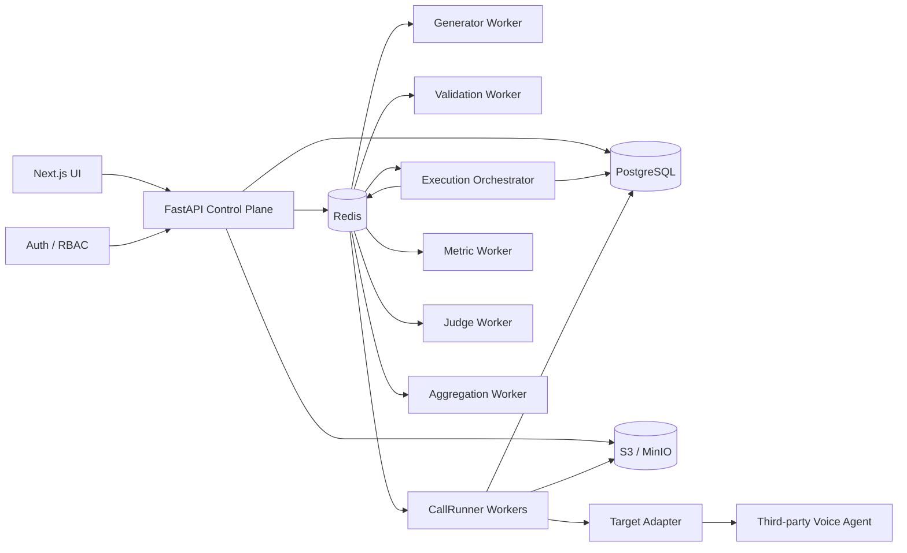

# VoiceEval — Backend API, Realtime Protocol & Process Flow Design

## 1. Backend topology



### Components

| Component              | Responsibility                                                           |
| ---------------------- | ------------------------------------------------------------------------ |
| FastAPI                | CRUD, validation requests, plan creation, execution control, result APIs |
| PostgreSQL             | Durable domain state and normalized runtime/evaluation data              |
| Redis                  | Queueing, job coordination, ephemeral execution state, pub/sub           |
| S3/MinIO               | Original audio, analysis audio, raw provider payloads, large artifacts   |
| Generator Worker       | Test/evaluator generation                                                |
| Validation Worker      | Evaluator + capability validation                                        |
| Execution Orchestrator | Expands plans into logical `CallRun`s and dispatches attempts            |
| CallRunner             | Actual realtime conversation                                             |
| Metric Worker          | Deterministic metric computation                                         |
| Judge Worker           | Structured/LLM evaluation                                                |
| Aggregation Worker     | Aggregate + composite calculation                                        |

The runtime runner is intentionally disposable and horizontally scalable.

---

# 2. API design principles

The API is divided into five surfaces:

```text
1. Configuration API
2. Evaluator API
3. Execution API
4. Runtime/runner API
5. Result/forensics API
```

Do **not** expose database tables directly as REST resources.

The API should expose domain operations.

---

# 3. API versioning

Base:

```text
/api/v1
```

Headers:

```http
Authorization: Bearer <token>
Content-Type: application/json
Idempotency-Key: <uuid>
X-Request-ID: <uuid>
```

Every state-changing execution request requires an idempotency key. The state-machine specification explicitly requires this to prevent duplicate logical repetitions.

---

# 4. Agent Target APIs

An `AgentTarget` is the logical identity.

An `AgentTargetRevision` is the executable configuration.

That distinction must remain intact.

## Create target

```http
POST /api/v1/targets
```

Request:

```json
{
  "name": "Acme Voice Agent",
  "provider": "acme",
  "description": "Production support agent"
}
```

Response:

```json
{
  "id": "agt_01J...",
  "name": "Acme Voice Agent",
  "provider": "acme"
}
```

---

## Create target revision

```http
POST /api/v1/targets/{target_id}/revisions
```

Request:

```json
{
  "transport": "websocket",
  "adapter_name": "acme_ws",
  "adapter_version": "2.1.0",

  "endpoint_config": {
    "url": "wss://agent.example.com/voice",
    "protocol_version": "v3"
  },

  "capability_snapshot": {
    "audio": {
      "caller_ingress": true,
      "agent_egress": true
    },
    "transcript": {
      "target_input": false,
      "target_output": true,
      "independent_asr_possible": true
    },
    "events": {
      "turn_boundaries": true,
      "text_stream": true,
      "interruptions": false,
      "connection_events": true
    },
    "tools": {
      "calls": true,
      "results": true
    }
  }
}
```

Backend:

```text
validate endpoint
        ↓
validate adapter exists
        ↓
validate capability schema
        ↓
calculate config_hash
        ↓
persist revision
```

Secrets should **never** be stored inside `endpoint_config`; the domain schema explicitly restricts it to non-secret configuration or secret references.

---

## Get target

```http
GET /api/v1/targets/{target_id}
```

## List targets

```http
GET /api/v1/targets
```

## Get revision

```http
GET /api/v1/targets/{target_id}/revisions/{revision_id}
```

---

# 5. Evaluator APIs

The evaluator lifecycle is:

```text
GENERATED
   ↓
DRAFT
   ↓
VALIDATING
   ├── error → DRAFT
   ↓
VALIDATED
   ↓
APPROVED
   ↓
EXECUTED
```

Once an execution manifest references the revision, its contents are immutable.

---

## Create evaluator

```http
POST /api/v1/evaluators
```

```json
{
  "evaluator_key": "credit_card_unblock",
  "name": "Credit Card Unblock",
  "suite_kind": "custom"
}
```

---

## Create evaluator revision

```http
POST /api/v1/evaluators/{evaluator_id}/revisions
```

```json
{
  "content": {
    "schema_version": "evaluator.v1",
    "persona": {},
    "language": {},
    "facts": [],
    "initial_state": {},
    "motive": {},
    "behaviour": {},
    "stop_conditions": {},
    "evaluation_criteria": {}
  }
}
```

Backend:

```text
create revision
      ↓
status = DRAFT
      ↓
return revision_id
```

---

# 6. Evaluator validation

```http
POST /api/v1/evaluator-revisions/{revision_id}/validate
```

This does **not** synchronously execute validation.

Instead:

```text
API
 ↓
status = VALIDATING
 ↓
enqueue validation.job
 ↓
return 202
```

Response:

```json
{
  "revision_id": "evalrev_01J...",
  "status": "validating",
  "job_id": "job_01J..."
}
```

---

## Validation worker flow

```text
Validation Job
      │
      ├── schema validation
      ├── scenario validation
      ├── motive validation
      ├── state consistency
      ├── success-condition validation
      ├── behaviour validation
      ├── language validation
      ├── criteria validation
      └── capability validation
                │
                ▼
        ValidationReport
```

The evaluator is executable only when scenario, motive, state, success conditions, behaviour, language, criteria and required capabilities are valid.

---

# 7. Capability negotiation

This should happen **before execution**, not during a call.

```text
TargetRevision
      ↓
CapabilitySnapshot
      ↓
Evaluator requirements
      ↓
Metric requirements
      ↓
Capability matrix
      ↓
ValidationReport
      ↓
ExecutionPlan
```

For example:

```text
TTFT
  requires → target_text_stream

tool_argument_correctness
  requires → tool_calls

target_agent_input_WER
  requires → target_input_transcript
```

If a required signal is absent:

```text
required metric → blocking validation failure
optional metric → NOT_AVAILABLE
```

This prevents discovering halfway through a 75-call benchmark that the target exposes no tool events.

---

# 8. Benchmark APIs

```http
POST /api/v1/benchmarks
GET  /api/v1/benchmarks
GET  /api/v1/benchmarks/{id}
```

Create version:

```http
POST /api/v1/benchmarks/{id}/versions
```

Freeze:

```http
POST /api/v1/benchmark-versions/{version_id}/freeze
```

Once frozen:

```text
benchmark_version
      ↓
IMMUTABLE
```

Benchmark cases reference evaluator revisions.

---

# 9. Evaluation Plan APIs

The `EvaluationPlan` is the execution contract. It references the target revision, benchmark/custom suite and repeat count.

## Create plan

```http
POST /api/v1/evaluation-plans
```

Example:

```json
{
  "kind": "benchmark",

  "benchmark_version_id": "benchver_01J...",

  "agent_target_revision_id": "targetrev_01J...",

  "repeat_count": 3
}
```

For custom:

```json
{
  "kind": "custom",
  "test_descriptor_revision_id": "tdrev_01J...",
  "agent_target_revision_id": "targetrev_01J...",
  "repeat_count": 3
}
```

---

# 10. Plan preparation

```http
POST /api/v1/evaluation-plans/{plan_id}/prepare
```

This is an important endpoint.

It performs:

```text
load target revision
       ↓
load evaluators
       ↓
verify evaluator revisions APPROVED
       ↓
resolve metric definitions
       ↓
resolve judge definitions
       ↓
resolve aggregation definition
       ↓
capability negotiation
       ↓
create immutable ExecutionManifest
       ↓
expand EvaluationPlanItem
       ↓
status = READY
```

The manifest captures target/evaluator/benchmark/caller/metric/judge/aggregation/composite snapshots plus versions, hashes and runtime information.

---

# 11. Execution manifest

The manifest becomes the **execution truth**.

```text
EvaluationPlan
      │
      ▼
ExecutionManifest
      │
      ├── target snapshot
      ├── evaluator snapshots
      ├── benchmark snapshot
      ├── caller configuration
      ├── metric definitions
      ├── judge definitions
      ├── aggregation
      ├── composite
      └── runtime versions
```

After creation:

```text
manifest = IMMUTABLE
```

Every `CallAttempt` points to it.

---

# 12. Start execution

```http
POST /api/v1/evaluation-plans/{plan_id}/execute
Idempotency-Key: plan:{plan_id}:execute:v1
```

Response:

```json
{
  "plan_id": "plan_01J...",
  "status": "queued",
  "job_id": "job_01J..."
}
```

The endpoint must be idempotent.

Calling it twice with the same idempotency key must **not** create another set of logical repetitions.

---

# 13. Execution orchestration

The orchestrator does:

```text
PLAN
 │
 ├── Item 1
 │    ├── Run 1
 │    ├── Run 2
 │    └── Run 3
 │
 ├── Item 2
 │    ├── Run 1
 │    ├── Run 2
 │    └── Run 3
 │
 └── Item N
      ├── Run 1
      ├── Run 2
      └── Run 3
```

Important:

```text
CallRun = statistical sample
CallAttempt = physical execution
```

A retry creates another attempt, **never another repetition**.

---

# 14. Run creation

For each plan item:

```sql
INSERT INTO call_run (...)
VALUES (
    ...,
    repetition_no = 1,
    status = 'queued'
);
```

with:

```text
UNIQUE(
    evaluation_plan_id,
    plan_item_id,
    repetition_no
)
```

This database constraint is the final protection against duplicate statistical samples.

---

# 15. Dispatch model

Redis jobs:

```text
execution.plan.start
execution.run.start
execution.attempt.start

metrics.compute
judge.execute
aggregation.compute
composite.compute
```

A simplified queue structure:

```text
voiceeval:queue:generation
voiceeval:queue:validation
voiceeval:queue:execution
voiceeval:queue:metrics
voiceeval:queue:judges
voiceeval:queue:aggregation
```

---

# 16. Call attempt creation

Before dispatching a runner:

```text
CallRun
   ↓
create CallAttempt
   ↓
attempt_no = previous_max + 1
   ↓
status = QUEUED
   ↓
dispatch runner job
```

Runner receives:

```json
{
  "attempt_id": "att_01J...",
  "call_run_id": "run_01J...",
  "execution_manifest_id": "manifest_01J...",
  "target_revision_id": "targetrev_01J...",
  "evaluator_revision_id": "evalrev_01J...",
  "run_seed": 982173,
  "trace_id": "trace_01J..."
}
```

---

# 17. Runner lifecycle

```text
QUEUED
   ↓
STARTING
   ↓
CONNECTING
   ↓
RUNNING
   ↓
TERMINATING
   ↓
TERMINAL
```

Exactly as defined in the attempt state machine.

---

# 18. CallRunner internal architecture

```text
CallRunner
│
├── ManifestLoader
│
├── CallerController
│   ├── ScenarioState
│   ├── PolicyEngine
│   ├── ActionSelector
│   └── LanguageController
│
├── MediaEngine
│   ├── AudioSource
│   ├── TTS
│   ├── Resampler
│   └── VAD
│
├── TargetAdapter
│   ├── WebSocketAdapter
│   └── WebRTCAdapter
│
├── ObservationNormalizer
│
├── EventCollector
│
├── MediaRecorder
│
├── StopConditionEngine
│
└── AttemptSupervisor
```

This directly follows the runtime component boundary in the architecture.

---

# 19. Realtime boundary

There are **two completely different realtime connections**:

```text
A. Runner → Target
   actual voice conversation

B. Runner → Backend
   telemetry/control channel
```

Do not mix them.

The control API should never sit in the audio path.

---

# 20. Runner control WebSocket

Recommended:

```text
WS /internal/v1/attempts/{attempt_id}/stream
```

Authentication:

```text
short-lived runner token
```

Purpose:

```text
runner registration
heartbeat
control commands
runtime event streaming
attempt status
cancellation
```

This is **not** the target-agent WebSocket.

---

# 21. Runner WebSocket protocol

### Client → server

```json
{
  "type": "runner.register",
  "attempt_id": "att_01J...",
  "runner_id": "runner_17",
  "runner_version": "0.3.2",
  "adapter_version": "acme-ws-2.1"
}
```

Heartbeat:

```json
{
  "type": "runner.heartbeat",
  "attempt_id": "att_01J...",
  "monotonic_ms": 48291
}
```

Runtime event:

```json
{
  "type": "runtime.event",
  "event": {
    "event_id": "evt_01J...",
    "call_attempt_id": "att_01J...",
    "sequence": 184,
    "type": "agent.audible.start",
    "source": "derived",
    "monotonic_ms": 12420,
    "wall_clock": "2026-09-29T12:35:22.420Z",
    "media_timestamp": 918273,
    "turn_id": "turn_17",
    "payload": {}
  }
}
```

The canonical runtime event envelope is defined around event ID, attempt ID, sequence, type, source and explicit clock information.

---

# 22. Server → runner control messages

Cancellation:

```json
{
  "type": "attempt.cancel",
  "reason": "USER_REQUESTED"
}
```

Shutdown:

```json
{
  "type": "attempt.terminate",
  "reason": "PLAN_CANCELLED"
}
```

Heartbeat acknowledgement:

```json
{
  "type": "runner.heartbeat_ack",
  "server_time": "..."
}
```

---

# 23. Event ingestion strategy

Do **not** synchronously perform all database work for every realtime event.

Instead:

```text
Runner
  │
  │ event
  ▼
Ingress
  │
  ├── append raw event
  │
  └── enqueue normalization
            │
            ▼
       Materializer
            │
            ├── call_turn
            ├── tool_call
            ├── state_transition
            └── derived events
```

The runtime specification explicitly requires raw events to remain append-only while derived/materialized objects remain rebuildable.

---

# 24. Event storage pipeline

```text
Provider wire event
       ↓
Raw event capture
       ↓
runtime_event(source=provider_raw)
       ↓
Adapter decoder
       ↓
provider_normalized event
       ↓
Canonical Event
       ↓
Event Materializer
       ├── turn
       ├── tool_call
       ├── language event
       └── state/evaluation evidence
```

Never replace raw provider evidence with normalized evidence.

---

# 25. Event ordering

Each attempt owns a monotonically increasing sequence:

```text
1
2
3
...
184
185
```

Database:

```text
UNIQUE(call_attempt_id, sequence_no)
```

The runtime spec also requires sequences to strictly increase while monotonic timestamps are non-decreasing.

Late provider events are therefore not allowed to mutate history.

They are appended and used during materialization/reconciliation.

---

# 26. Event deduplication

If provider supplies:

```text
provider_event_id
```

use:

```text
UNIQUE(source, provider_event_id)
```

Otherwise derive an adapter-specific fingerprint:

```text
hash(
    event_type,
    timestamp_bucket,
    payload_hash,
    sequence_context
)
```

The source explicitly avoids assuming that providers have stable event IDs.

---

# 27. WebSocket target adapter

The runner's target connection:

```text
CallRunner
   ↓
WebSocketAdapter
   ↓
WebSocket
   ↓
Third-party agent
```

Adapter responsibilities:

```text
connect()
send_audio()
receive()
decode_message()
normalize_event()
close()
```

The architecture deliberately separates transport from provider semantics and evaluation semantics.

---

# 28. Target WebSocket flow

```text
CONNECT
  ↓
connection.requested
  ↓
WS OPEN
  ↓
connection.ws.open
  ↓
send initial provider handshake
  ↓
receive provider messages
  ↓
provider_raw events
  ↓
decode
  ↓
provider_normalized events
  ↓
canonical events
  ↓
caller / media / evaluator loop
```

A WebSocket message is **not** assumed to represent one audio frame or one conversational turn. The provider adapter owns those semantics.

---

# 29. WebRTC target adapter

```text
CallRunner
   ↓
WebRTCAdapter
   ├── SignalingAdapter
   ├── PeerConnection
   ├── ICEManager
   ├── AudioTrackManager
   └── ConnectionStateMonitor
```

The target revision must contain the signaling contract.

```text
signaling URL/method
offer/answer format
ICE candidate exchange
codec expectations
authentication
audio track expectations
```

A bare `webrtc://...` endpoint is insufficient because application-level signaling is outside the WebRTC API.

---

# 30. WebRTC signaling flow

```text
Runner
  │
  │ connection.signaling.start
  ▼
SignalingAdapter
  │
  │ SDP offer
  ▼
Target signaling service
  │
  │ SDP answer
  ▼
Runner
  │
  ├── ICE candidates
  ├── ICE connected
  ├── PeerConnection connected
  └── audio track received
```

Events:

```text
connection.rtc.peer_created
connection.rtc.ice_state_changed
connection.rtc.connection_state_changed
connection.rtc.track_received
```

These events are part of the canonical runtime vocabulary.

---

# 31. Media path

```text
Synthetic Caller
      │
      ▼
AudioSource
      │
      ▼
Resampler
      │
      ▼
Target Transport
      │
      ▼
Third-party Agent
      │
      ▼
Agent Audio
      │
      ├───────────────┐
      ▼               ▼
MediaRecorder        VAD
      │               │
      ▼               ▼
Original Artifact   Audible Events
```

Maintain:

```text
original artifact
analysis artifact
```

Original audio must remain immutable.

---

# 32. Caller control loop

The synthetic caller should be state-machine driven:

```text
Observed Agent Output
        ↓
State Update
        ↓
Policy Evaluation
        ↓
Action Selection
        ↓
Language Realization
        ↓
TTS
        ↓
Audio Transmission
```

The LLM should primarily realize the selected action rather than become the authoritative state machine.

---

# 33. Caller state

Example runtime state:

```json
{
  "state_version": 17,

  "facts": {},

  "user_goal": "unblock_card",

  "current_intent": "request_resolution",

  "authentication_state": "authenticated",

  "known_information": {},

  "recovery_count": 1,

  "allowed_actions": [
    "answer_question",
    "correct_misunderstanding",
    "end_call"
  ],

  "conversation_phase": "resolution",

  "terminal_status": null
}
```

Every state mutation creates:

```text
state_transition
```

rather than only storing the final state.

---

# 34. Caller decision event

```json
{
  "type": "caller.action.selected",

  "payload": {
    "action": "correct_misunderstanding",
    "state_version": 17,
    "recovery_count": 1
  }
}
```

Then:

```text
caller.action.selected
       ↓
caller.utterance.realized
       ↓
TTS
       ↓
caller.media.start
       ↓
caller.media.chunk*
       ↓
caller.media.end
```

---

# 35. Stop-condition engine

After every normalized event:

```text
StopConditionEngine.evaluate(event)
```

Precedence:

```text
1. NATURAL_SUCCESS
2. RECOVERY_EXHAUSTED
3. IRRECOVERABLE_OBJECTIVE_FAILURE
4. CONVERSATION_STALL
5. WALL_CLOCK_TIMEOUT
6. CONNECTION_FAILURE
```

The first triggering evidence event must be retained.

---

# 36. Natural success

Example:

```text
authentication.completed
        AND
card.unblocked
        AND
caller acknowledges
```

Then:

```text
caller.action.selected(end_call)
        ↓
caller.terminal
        ↓
attempt.terminal
```

Natural success requires every required motive assertion to be satisfied.

---

# 37. Recovery exhaustion

```text
agent misunderstanding
        ↓
caller correction
        ↓
recovery_count++
        ↓
agent misunderstanding again
        ↓
caller correction
        ↓
recovery_count++
        ↓
count > max_recovery_attempts
        ↓
RECOVERY_EXHAUSTED
```

This is a semantic evaluation outcome, **not an infrastructure failure**, and therefore should not automatically trigger a new attempt.

---

# 38. Stall detection

Do not reset the stall timer merely because network packets are arriving.

Track:

```text
last_meaningful_agent_response
```

For example:

```text
no meaningful audible agent response > 10 sec
        ↓
CONVERSATION_STALL
```

The architecture specifically distinguishes meaningful response from network activity.

---

# 39. Attempt termination

Runner emits exactly one:

```text
attempt.terminal
```

Example:

```json
{
  "type": "attempt.terminal",

  "payload": {
    "status": "completed",
    "termination_reason": "NATURAL_SUCCESS"
  }
}
```

This event becomes immutable after finalization.

---

# 40. Attempt finalization

Backend receives terminal event:

```text
attempt.terminal
       ↓
flush event buffer
       ↓
flush media
       ↓
finalize media artifacts
       ↓
materialize final turns
       ↓
materialize tool calls
       ↓
materialize state transitions
       ↓
determine evaluation eligibility
       ↓
finalize CallAttempt
```

Then:

```text
eligible_for_evaluation = true
```

or:

```text
eligible_for_evaluation = false
```

depending on evidence.

---

# 41. Retry decision

```text
Attempt terminal
       ↓
classify failure
       ↓
       ├── semantic failure
       │      ↓
       │    NO RETRY
       │
       └── infrastructure/transient failure
              ↓
           RETRY POLICY
              ↓
           new Attempt
```

Retryable examples:

```text
runner crash
connection setup failure
transient provider failure
temporary worker failure
```

Non-retryable:

```text
agent misunderstood
motive failed
recovery exhausted
```

This distinction is explicitly required by the state-machine design.

---

# 42. Example retry

```text
CallRun #17
│
├── Attempt #1
│     CONNECTING
│       ↓
│     ICE_FAILURE
│       ↓
│     ineligible
│
└── Attempt #2
      CONNECTING
        ↓
      RUNNING
        ↓
      COMPLETED
        ↓
      eligible
```

Statistics:

```text
sample_count += 1
```

not:

```text
sample_count += 2
```

---

# 43. Metric pipeline

After an eligible attempt:

```text
CallAttempt
    ↓
metric.compute job
    ↓
Metric Engine
```

Metric engine loads:

```text
ExecutionManifest
CallTurns
RuntimeEvents
ToolCalls
StateTransitions
MediaArtifacts
Evaluator
MetricDefinitions
```

Then computes deterministic metrics.

---

# 44. Deterministic metric examples

```text
TTFA
TTFT
interruption_latency
turn_duration
call_duration
agent_input_wer
independent_asr_wer
tool_argument_exactness
tool_order_correctness
duplicate_tool_calls
```

The result stores its measurement basis rather than merely a number.

Example:

```json
{
  "metric": "ttfa",
  "status": "computed",

  "value_numeric": 720,
  "unit": "ms",

  "method": "deterministic",

  "measurement_basis": {
    "start_event": "caller.audible.end",
    "end_event": "agent.audible.start",
    "clock": "runner_monotonic"
  }
}
```

---

# 45. Metric availability

Never:

```text
missing evidence → 0
```

Instead:

```text
COMPUTED
NOT_AVAILABLE
NOT_APPLICABLE
INVALID
ERROR
```

For example:

```text
target has no text stream
        ↓
TTFT = NOT_AVAILABLE
```

rather than:

```text
TTFT = 0
```

The result schema explicitly separates these states.

---

# 46. Judge pipeline

Qualitative metrics go through:

```text
CallRun
   ↓
Judge Worker
   ↓
build trusted evaluation context
   ↓
LLM / structured judge
   ↓
parse JSON
   ↓
schema validation
   ↓
evidence validation
   ↓
JudgeExecution
   ↓
MetricResult
```

Observed target text must be treated as **untrusted data**, not instructions to the judge.

---

# 47. Judge request

Conceptually:

```json
{
  "trusted": {
    "evaluator": {},
    "rubric": {},
    "evaluation_policy": {}
  },

  "untrusted": {
    "caller_turns": [],
    "agent_turns": [],
    "provider_events": [],
    "tool_calls": []
  }
}
```

The target must never be able to change:

```text
rubric
score range
evaluation rules
system instructions
```

---

# 48. Judge output validation

```text
LLM output
    ↓
JSON parse
    ↓
schema validation
    ↓
required fields
    ↓
range validation
    ↓
reason-code validation
    ↓
evidence-reference validation
```

Failure:

```text
JudgeExecution = INVALID
MetricResult = ERROR
```

Never silently coerce malformed output into a valid score.

---

# 49. Motive evaluation

Motive assertions should be evaluated against evidence precedence:

```text
1. External/state oracle
2. Verified tool result
3. Provider structured event
4. Conversation evidence
5. LLM inference
```

If evidence conflicts:

```text
outcome_status = CONFLICT
```

and both evidence paths remain stored.

---

# 50. Evidence creation

Every metric result can produce:

```text
Evidence
```

Example:

```json
{
  "metric_result_id": "mr_01J...",

  "source_type": "turn",
  "source_id": "turn_19",

  "start_ms": 11720,
  "end_ms": 13100,

  "quote": "Nahi, replacement nahi chahiye.",

  "rationale": "Caller explicitly corrected the agent."
}
```

Evidence may reference:

```text
turn
event
tool_call
audio
state_transition
```

This creates the forensic chain:

```text
Metric
 ↓
Evidence
 ↓
Turn/Event/Tool/State
 ↓
Audio
```

---

# 51. Aggregation pipeline

Once all logical runs for a plan item have terminal states:

```text
CallRuns
   ↓
MetricResults
   ↓
Aggregation Worker
   ↓
AggregateResult
   ↓
Composite Worker
   ↓
CompositeScoreResult
```

The aggregate must operate on **CallRuns**, not attempts.

---

# 52. Aggregation

For continuous metrics:

```text
mean
median
min
max
stddev
p95
```

For boolean:

```text
true_count
false_count
success_rate
```

For categorical:

```text
category_counts
category_percentages
```

For MVP `n=3`:

```text
p95 = NULL
percentile_status = insufficient_sample
```

The complete raw sample set remains visible.

---

# 53. Coverage

Every aggregate includes:

```text
sample_count
coverage_count
availability_ratio
```

Example:

```text
75 logical samples

68 computed
7 unavailable

coverage = 90.67%
```

Coverage is metadata about observability, not a quality score.

---

# 54. Composite pipeline

```text
Raw metric
    ↓
Normalize to 0–100
    ↓
Category score
    ↓
Category weighting
    ↓
Composite
```

Never directly average heterogeneous units such as:

```text
4.2
812 ms
0.91
6.8
```

The production normalization and coverage policies must themselves be versioned.

---

# 55. Composite completion

```text
all critical metrics available
        AND
coverage >= threshold
        ↓
COMPLETE
```

Otherwise:

```text
INCOMPLETE
```

with:

```text
coverage_ratio
unavailable_weight
missing_metrics
```

No silent weight redistribution.

---

# 56. Evaluation plan completion

Orchestrator continuously evaluates:

```text
Are all CallRuns terminal?
```

If yes:

```text
aggregate
   ↓
composite
   ↓
plan = COMPLETED
```

If some logical runs fail terminally:

```text
plan = PARTIAL
```

`COMPLETED` means all logical repetitions reached a terminal state; it does not mean every physical attempt succeeded.

---

# 57. Cancellation

```http
POST /api/v1/evaluation-plans/{plan_id}/cancel
```

Flow:

```text
API
 ↓
plan status = CANCELLED
 ↓
publish cancellation command
 ↓
Orchestrator
 ↓
running CallAttempts
 ↓
runner.cancel
 ↓
attempt.terminal(CANCELLED)
```

Queued runs can be directly cancelled.

Running attempts require an explicit runner termination signal.

---

# 58. Resume / retry semantics

Do not expose:

```http
POST /plans/{id}/retry
```

as an ambiguous operation.

Instead distinguish:

```http
POST /api/v1/call-runs/{run_id}/retry
```

for an infrastructure-failed logical run.

And:

```http
POST /api/v1/evaluation-plans/{plan_id}/resume
```

only for continuing unfinished logical repetitions.

The important invariant is:

```text
resume/retry never creates a second sample for an existing repetition_no
```

---

# 59. Result APIs

## Plan summary

```http
GET /api/v1/evaluation-plans/{plan_id}/results
```

Response:

```json
{
  "plan": {},
  "status": "completed",

  "summary": {
    "evaluators": 25,
    "logical_runs": 75,
    "completed_runs": 75
  },

  "aggregates": [],
  "composite": {}
}
```

---

## Evaluator result

```http
GET /api/v1/evaluation-plans/{plan_id}/evaluators/{evaluator_revision_id}/results
```

Returns:

```text
aggregate metrics
run values
coverage
failure distribution
```

---

# 60. Run API

```http
GET /api/v1/call-runs/{run_id}
```

Response:

```json
{
  "run": {},
  "attempts": [],
  "metrics": [],
  "judges": [],
  "summary": {}
}
```

---

# 61. Attempt API

```http
GET /api/v1/call-attempts/{attempt_id}
```

Returns:

```text
attempt metadata
status
termination
failure class
runner version
adapter version
trace ID
timestamps
eligibility
```

---

# 62. Conversation API

```http
GET /api/v1/call-attempts/{attempt_id}/conversation
```

Response:

```json
{
  "turns": [],
  "languages": [],
  "interruptions": [],
  "tool_calls": []
}
```

---

# 63. Runtime event API

For debugging:

```http
GET /api/v1/call-attempts/{attempt_id}/events
```

Query:

```text
?source=provider_raw
&type=tool.call.end
&from_ms=10000
&to_ms=20000
```

Raw events remain append-only.

---

# 64. Evidence API

```http
GET /api/v1/metric-results/{metric_result_id}/evidence
```

Returns:

```json
{
  "metric_result": {},
  "evidence": [
    {
      "source_type": "turn",
      "source_id": "turn_19",
      "start_ms": 11720,
      "end_ms": 13100
    }
  ]
}
```

---

# 65. Media API

Never stream large media through PostgreSQL.

Instead:

```http
GET /api/v1/media/{media_artifact_id}/url
```

Response:

```json
{
  "url": "<short-lived-signed-url>",
  "expires_at": "..."
}
```

The database stores:

```text
object_uri
sha256
size_bytes
format
codec
clock_domain
```

as specified by the media artifact model.

---

# 66. Forensic API

One endpoint should reconstruct the entire debugging context:

```http
GET /api/v1/call-runs/{run_id}/forensics
```

Response:

```json
{
  "evaluation_plan": {},
  "evaluator": {},
  "run": {},
  "attempt": {},

  "summary": {
    "metrics": [],
    "scores": []
  },

  "conversation": {
    "turns": [],
    "events": [],
    "tool_calls": []
  },

  "state": {
    "transitions": []
  },

  "evidence": [],

  "media": []
}
```

This directly supports the intended:

```text
aggregate
   ↓
evaluator
   ↓
run
   ↓
turn
   ↓
evidence
   ↓
audio
```

forensic workflow.

---

# 67. Live UI WebSocket

Separately from the runner WebSocket:

```text
WS /api/v1/evaluation-plans/{plan_id}/live
```

This is **UI observability**, not execution transport.

The UI subscribes to:

```text
plan.status.changed
run.status.changed
attempt.status.changed
metric.computed
judge.completed
aggregate.updated
composite.updated
```

Example:

```json
{
  "type": "attempt.status.changed",

  "data": {
    "attempt_id": "att_01J...",
    "status": "running"
  }
}
```

---

# 68. Live UI flow

```text
CallRunner
   ↓
Event Ingestion
   ↓
Postgres / Redis PubSub
   ↓
API WebSocket
   ↓
Next.js UI
```

The UI therefore receives live updates without being inserted into the actual voice/media path.

---

# 69. Recommended internal event bus

Use an internal event envelope:

```json
{
  "event_id": "evt_01J...",
  "event_type": "attempt.terminal",

  "aggregate_type": "call_attempt",
  "aggregate_id": "att_01J...",

  "occurred_at": "...",

  "trace_id": "trace_01J...",

  "payload": {}
}
```

Examples:

```text
evaluator.validated
plan.prepared
plan.queued

run.created
run.started
run.completed

attempt.created
attempt.started
attempt.terminal

metric.completed
judge.completed

aggregation.completed
composite.completed

plan.completed
```

This is an **internal orchestration event**, distinct from the canonical runtime events emitted during a call.

---

# 70. Worker job schema

The worker layer follows:

```text
Job
├── id
├── type
├── target_id
├── attempt
├── status
├── idempotency_key
├── input_hash
├── started_at
├── finished_at
├── error_code
└── created_at
```

as defined by the state-machine document.

Recommended additional fields:

```text
trace_id
parent_job_id
attempt_count
available_at
locked_until
worker_id
```

---

# 71. Job idempotency

Every job gets:

```text
job:{type}:{logical_resource_id}:{input_hash}
```

Example:

```text
metric:compute:run_123:sha256(...)
```

This means if a worker crashes after computation but before acknowledgement:

```text
same job
   ↓
same input_hash
   ↓
existing result detected
   ↓
no duplicate result
```

---

# 72. Worker retry policy

Safe retries:

```text
generation
validation
metrics
judging
aggregation
```

Voice execution is different:

```text
CallRun
  └── CallAttempt #1
  └── CallAttempt #2
  └── CallAttempt #3
```

A worker retry must **never** accidentally create another logical run.

---

# 73. Full end-to-end flow

The entire system becomes:

```text
                         CONTROL PLANE

User
 │
 ▼
POST /evaluators
 │
 ▼
EvaluatorRevision
 │
 ▼
POST /validate
 │
 ▼
ValidationWorker
 │
 ├── scenario
 ├── motive
 ├── state
 ├── behaviour
 ├── language
 ├── metrics
 └── capabilities
 │
 ▼
APPROVED
 │
 ▼
POST /evaluation-plans
 │
 ▼
POST /prepare
 │
 ▼
ExecutionManifest
 │
 ▼
READY
 │
 ▼
POST /execute
 │
 ▼
QUEUED
 │
 ▼
ExecutionOrchestrator
 │
 ├─────────────────────────────┐
 ▼                             ▼
CallRun 1                     CallRun N
 │                             │
 ▼                             ▼
CallAttempt                   CallAttempt
 │
 ▼
STARTING
 │
 ▼
CONNECTING
 │
 ├──────────── WebSocket
 │
 └──────────── WebRTC
 │
 ▼
RUNNING
 │
 ▼
Synthetic Caller ↔ Voice Agent
 │
 ├── audio
 ├── transcript
 ├── tools
 ├── language
 ├── interruptions
 └── state transitions
 │
 ▼
TERMINATING
 │
 ▼
attempt.terminal
 │
 ▼
eligible?
 │
 ├── no → retry policy
 │
 └── yes
       │
       ▼
 Metric Worker
       │
       ├── deterministic metrics
       │
       ▼
 Judge Worker
       │
       ├── structured judge
       └── LLM judge
       │
       ▼
 Metric Results
       │
       ▼
 Aggregation Worker
       │
       ▼
 Aggregate Results
       │
       ▼
 Composite Worker
       │
       ▼
 Composite Score
       │
       ▼
EvaluationPlan = COMPLETED
```

---

# 74. Concrete API surface

The MVP can therefore start with approximately this API:

```text
TARGETS
────────────────────────────────────────────
POST   /api/v1/targets
GET    /api/v1/targets
GET    /api/v1/targets/{id}
POST   /api/v1/targets/{id}/revisions
GET    /api/v1/targets/{id}/revisions
GET    /api/v1/targets/{id}/revisions/{revision_id}


EVALUATORS
────────────────────────────────────────────
POST   /api/v1/evaluators
GET    /api/v1/evaluators
GET    /api/v1/evaluators/{id}
POST   /api/v1/evaluators/{id}/revisions
GET    /api/v1/evaluator-revisions/{id}
POST   /api/v1/evaluator-revisions/{id}/validate
POST   /api/v1/evaluator-revisions/{id}/approve


BENCHMARKS
────────────────────────────────────────────
POST   /api/v1/benchmarks
GET    /api/v1/benchmarks
POST   /api/v1/benchmarks/{id}/versions
POST   /api/v1/benchmark-versions/{id}/freeze
GET    /api/v1/benchmark-versions/{id}


PLANS
────────────────────────────────────────────
POST   /api/v1/evaluation-plans
GET    /api/v1/evaluation-plans
GET    /api/v1/evaluation-plans/{id}
POST   /api/v1/evaluation-plans/{id}/prepare
POST   /api/v1/evaluation-plans/{id}/execute
POST   /api/v1/evaluation-plans/{id}/cancel
POST   /api/v1/evaluation-plans/{id}/resume
GET    /api/v1/evaluation-plans/{id}/results


RUNS
────────────────────────────────────────────
GET    /api/v1/call-runs/{id}
POST   /api/v1/call-runs/{id}/retry
GET    /api/v1/call-runs/{id}/forensics


ATTEMPTS
────────────────────────────────────────────
GET    /api/v1/call-attempts/{id}
GET    /api/v1/call-attempts/{id}/events
GET    /api/v1/call-attempts/{id}/conversation
GET    /api/v1/call-attempts/{id}/media


RESULTS
────────────────────────────────────────────
GET    /api/v1/metric-results/{id}
GET    /api/v1/metric-results/{id}/evidence
GET    /api/v1/evaluation-plans/{id}/aggregates
GET    /api/v1/evaluation-plans/{id}/composite


MEDIA
────────────────────────────────────────────
GET    /api/v1/media/{id}/url


REALTIME
────────────────────────────────────────────
WS     /api/v1/evaluation-plans/{id}/live
WS     /internal/v1/attempts/{id}/stream
```

---

# 75. The three realtime channels must remain separate

This is one of the most important implementation details.

```text
                 ┌─────────────────────────┐
                 │       FastAPI API        │
                 └───────────┬─────────────┘
                             │
                       control/events
                             │
               ┌─────────────▼─────────────┐
               │       CallRunner          │
               └──────┬──────────┬─────────┘
                      │          │
             telemetry/control  │
                      │          │
              Backend WS         │
                                 │
                       target media connection
                                 │
                         ┌───────▼────────┐
                         │ Voice Agent    │
                         └────────────────┘
```

And separately:

```text
FastAPI
   │
   │ live UI events
   ▼
Browser WebSocket
```

So:

```text
Target WS/WebRTC ≠ Runner WS ≠ Browser WS
```

That separation will save you a **lot** of architectural pain later.

---

# 76. Source-of-truth hierarchy

Finally, the backend should enforce this hierarchy:

```text
TEST TRUTH
EvaluatorRevision
ExecutionManifest
        │
        ▼
OBSERVED TRUTH
CallAttempt
RuntimeEvent
CallTurn
ToolCall
MediaArtifact
StateTransition
        │
        ▼
EVALUATION TRUTH
MetricResult
JudgeExecution
Evidence
AggregateResult
CompositeScoreResult
```

This preserves the three-truth model from the architecture: what was intended, what actually happened, and what conclusion can be supported.

The most important consequence is:

**Never let a derived metric, LLM judge, normalized event, or dashboard result overwrite the underlying runtime evidence.**

Raw provider events remain append-only; turns are rebuildable; media is immutable; retries create attempts rather than samples; and missing observability is represented explicitly rather than converted into bad scores.
