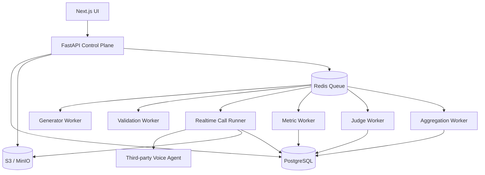

# VoiceEval — Architecture v0.3 (Strengthened)

> This design is a post-review implementation architecture for the VoiceEval Product Scope v0.1. The scope remains the product source of truth; this document adds engineering constraints required for reproducibility, black-box evaluation, and reliable operation.

## 1. What the system is actually optimizing

VoiceEval has three distinct truths:

```text
TEST TRUTH
What did we intend to test?
        │
        ▼
Evaluator Revision

OBSERVED TRUTH
What actually happened?
        │
        ▼
Call Run + Call Attempt + Runtime Evidence

EVALUATION TRUTH
What conclusion can we support from that evidence?
        │
        ▼
Metric Results + Judge Results + Evidence
```

Never collapse these layers.

The Product Scope explicitly separates Evaluator, Call Run, and Evaluation Result. fileciteturn0file0L1284-L1321

---

## 2. Recommended deployment topology

Do **not** start with independent microservices for every box.

Use one control-plane application plus specialized workers:



The realtime runner is the special component. It should be horizontally scalable and disposable.

---

## 3. Control plane responsibilities

FastAPI owns:

```text
AgentTarget
AgentTargetRevision

TestDescriptor
TestDescriptorRevision

Evaluator
EvaluatorRevision
ValidationReport

Benchmark
BenchmarkVersion
BenchmarkCase

EvaluationPlan
EvaluationPlanItem

MetricDefinition
JudgeDefinition

ExecutionManifest
Result queries
```

The control plane does **not** hold live WebRTC/WebSocket audio state.

---

## 4. Realtime runtime boundary

A `CallRun` is one **logical repetition**.

A `CallAttempt` is one **physical execution attempt**.

This distinction matters.

```text
Evaluator #17
    │
    ├── CallRun / repetition 1
    │      ├── Attempt 1 → runner crash
    │      └── Attempt 2 → completed
    │
    ├── CallRun / repetition 2
    │      └── Attempt 1 → completed
    │
    └── CallRun / repetition 3
           └── Attempt 1 → completed
```

The aggregate sees **3 repetitions**, not 4 attempts.

A retry must never silently manufacture an extra statistical sample.

---

## 5. Runtime component model

```text
CallRunner
├── ExecutionManifest
├── CallerController
│   ├── ScenarioState
│   ├── PolicyEngine
│   ├── ActionSelector
│   └── LanguageController
├── MediaEngine
│   ├── AudioSource
│   ├── TTS
│   ├── Resampler
│   └── VAD / timing detector
├── Transport
│   ├── WebSocket
│   └── WebRTC
├── Signaling
│   └── Required for WebRTC where target protocol demands it
├── ObservationNormalizer
├── EventCollector
├── MediaRecorder
├── StopConditionEngine
└── AttemptSupervisor
```

---

## 6. WebRTC architecture correction

WebRTC is not just:

```text
connect()
send_audio()
receive_audio()
```

A usable implementation also has to handle:

```text
signaling
SDP offer/answer
ICE candidate gathering
ICE candidate exchange
STUN/TURN configuration
media track negotiation
connection state
ICE restart / reconnection handling
```

WebRTC specifications do not define application signaling; the peers need another channel to exchange SDP/ICE information, and ICE commonly uses STUN/TURN for connectivity across NATs and firewalls. citeturn826333search0turn826333search2

Therefore the abstraction should be:

```text
WebRTCAdapter
├── SignalingAdapter
├── PeerConnection
├── AudioTrackManager
├── ICEManager
└── ConnectionStateMonitor
```

For MVP, support only explicitly documented WebRTC signaling contracts. Do not claim generic WebRTC compatibility without a signaling contract.

---

## 7. WebSocket architecture

WebSocket is simpler at the connection layer, but the payload protocol is still provider-specific.

```text
WebSocketTransport
      │
      ▼
FrameDecoder
      │
      ▼
Provider/Protocol Decoder
      │
      ▼
Canonical Event Builder
```

Do not assume:

```text
1 websocket message = 1 audio frame
```

or:

```text
1 message = 1 turn
```

The wire protocol remains adapter-owned.

WebSocket message fragments are delivered in order, but the application payload semantics are still defined by the protocol built on top of WebSocket. citeturn592638search6

---

## 8. Canonical transport-neutral interface

```python
class AgentConnection(Protocol):
    async def connect(self, config: ConnectionConfig) -> None: ...
    async def send_audio(self, chunk: AudioChunk) -> None: ...
    async def receive(self) -> AsyncIterator[RawAgentEvent]: ...
    async def close(self, reason: CloseReason) -> None: ...

    def capabilities(self) -> CapabilitySnapshot: ...
```

Important:

```text
Transport ≠ Provider semantics ≠ Evaluation semantics
```

Keep them separate.

---

## 9. Capability discovery

Each target revision stores a capability snapshot:

```yaml
audio:
  caller_ingress: true
  agent_egress: true

transcript:
  target_input: false
  target_output: true
  independent_asr_possible: true

events:
  turn_boundaries: true
  text_stream: true
  interruptions: false
  connection_events: true

tools:
  calls: true
  results: true

timing:
  media_timestamps: true
  text_timestamps: true
```

Metric definitions declare required capabilities.

Example:

```yaml
metric: ttft
requires:
  - target_text_stream

metric: agent_input_wer
requires:
  - target_input_transcript

metric: tool_argument_correctness
requires:
  - tool_calls
```

---

## 10. Availability semantics

These are not interchangeable:

```text
COMPUTED
NOT_AVAILABLE
NOT_APPLICABLE
INVALID
ERROR
```

Never do:

```text
missing evidence → score 0
```

A provider that does not expose tool events has not necessarily made incorrect tool calls; VoiceEval simply cannot inspect them.

This follows the Product Scope's explicit capability-dependent tool-evaluation rule. fileciteturn0file0L412-L459

---

## 11. Immutable execution manifest

Before execution begins, create one immutable manifest:

```yaml
execution_manifest:
  schema_version: "1.0"

  target:
    revision_id: ...
    config_hash: ...

  evaluator:
    revision_id: ...
    content_hash: ...

  benchmark:
    version_id: ...

  caller:
    policy_version: ...
    tts_provider: ...
    tts_model_version: ...

  observation:
    asr_versions: ...

  metrics:
    - key: ttfa
      version: "1.0"
    - key: semantic_understanding
      version: "2.1"

  judges:
    - key: structured_conversation_judge
      version: "1.3"
      model: ...

  aggregation:
    version: "1.0"

  composite:
    definition_version: "1.0"

  runtime:
    runner_version: ...
    adapter_version: ...
```

Every call attempt points to this manifest.

This is stronger than merely storing version columns independently because the exact execution contract can be hashed and audited as one object.

---

## 12. Synthetic caller architecture

The caller must have structured authoritative state:

```text
Scenario State
├── facts
├── user_goal
├── current_intent
├── authentication_state
├── known_information
├── recovery_count
├── allowed_actions
├── conversation_phase
└── terminal_status
```

The LLM should not be allowed to invent arbitrary state transitions.

Preferred loop:

```text
Observed Agent Output
        ↓
State Update / Policy Evaluation
        ↓
Select Caller Action
        ↓
Realize Natural Language
        ↓
TTS
        ↓
Transmit
```

The language model is used mainly for **realization**, not authoritative truth.

---

## 13. Reproducibility model

A seed does not guarantee bit-identical reruns when external model providers are nondeterministic.

Therefore store:

```text
run_seed
policy_version
actual selected action sequence
actual realized caller utterances
TTS model/version
generated audio hash
runtime versions
```

The platform can then offer:

```text
CONFIGURATION REPRODUCIBILITY
Can we reconstruct the exact test configuration?

FORENSIC REPRODUCIBILITY
Can we inspect exactly what happened?

BITWISE REPRODUCIBILITY
Did an identical rerun produce identical tokens/audio?
```

Only claim the third when the underlying components actually provide deterministic behavior.

---

## 14. Audio architecture

Keep at least two representations:

```text
ORIGINAL / WIRE ARTIFACT
Exact captured source or negotiated media representation

ANALYSIS ARTIFACT
Normalized PCM representation used by VAD, WER/alignment,
latency analysis, and waveform tooling
```

Do not replace the original with a normalized derivative.

For each media artifact store:

```text
track
codec
sample_rate
channels
duration
clock_domain
object_uri
sha256
```

This is important for forensic inspection and future metric re-computation.

---

## 15. Time architecture

Use multiple clocks explicitly.

```text
wall_clock
    → human-facing timestamps

runner_monotonic_clock
    → latency calculations

media_clock / RTP timestamp
    → media alignment where available

sequence_number
    → deterministic event ordering
```

Do not calculate TTFA from wall-clock timestamps when a monotonic runtime clock is available.

For WebRTC media, keep media timestamps/SSRC information when available; the WebRTC spec exposes RTP timestamps associated with received media sources. citeturn826333search1

---

## 16. TTFA definition

Use:

```text
TTFA =
agent_audible_start
-
relevant_caller_turn_end
```

Not merely:

```text
first packet received
```

and not:

```text
agent.audio.start event
```

unless that event is known to correspond to audible output.

Introduce derived events:

```text
agent.media.start
agent.audible.start
agent.audible.end
```

The audible boundary can be derived from configured VAD/energy thresholds.

The Product Scope correctly distinguishes TTFA from TTFT and emphasizes the audible response experienced by the caller. fileciteturn0file0L495-L509

---

## 17. TTFT definition

Only compute TTFT when a target-agent text stream is actually observable.

```text
TTFT =
first meaningful agent text/token
-
relevant caller turn end
```

Define "meaningful" as the first non-empty semantic output event after trimming provider heartbeats/whitespace/control messages.

Record the `measurement_basis` with the metric result.

---

## 18. Interruption model

An interruption requires both:

```text
caller speech onset
+
agent speech currently active
```

Then:

```text
InterruptionLatency =
agent audible stop
-
caller speech onset
```

Also store:

```text
interruption_detected
agent_stopped
caller_continued
```

This separates:

```text
caller interrupted successfully
```

from:

```text
caller started speaking while agent was speaking
but agent continued talking
```

---

## 19. Outcome / motive architecture

Motive fulfillment should be evaluated through an assertion engine:

```text
Motive
  ↓
Assertions
  ↓
Observed evidence
  ↓
Oracle evaluation
  ↓
Assertion verdicts
  ↓
Motive verdict
```

Possible oracle types:

```text
conversation
caller_acknowledgement
tool_event
provider_state
external_state_oracle       # future / explicitly configured
```

Example:

```yaml
assertions:
  - id: auth_completed
    type: tool_event
    expectation:
      tool: authenticate_customer

  - id: card_unblocked
    type: tool_event
    expectation:
      tool: unblock_card
      args:
        card_last_four: "4821"

  - id: caller_ack
    type: caller_acknowledgement
```

The LLM may interpret conversational evidence, but it should not be the only source of truth when stronger evidence exists.

---

## 20. Evidence precedence

For outcome assertions, prefer:

```text
1. External/state oracle
2. Verified tool event/result
3. Provider structured event
4. Conversation inference
5. LLM-only interpretation
```

When multiple sources disagree, record the conflict.

Never silently choose one.

---

## 21. Judge architecture

The source describes a structured numerical/decision judge ("Jev") and a richer LLM judge. fileciteturn0file0L701-L735

Recommended structure:

```text
Structured Judge
  → typed JSON
  → rubric-driven
  → bounded scale

LLM Judge
  → failure analysis
  → evidence extraction
  → reason codes
  → recommended corrective behavior
```

The LLM judge is not authoritative by default for deterministic metrics.

---

## 22. Prompt-injection boundary

All target-agent content is untrusted.

The judge receives:

```text
SYSTEM POLICY
EVALUATOR DEFINITION
METRIC RUBRIC
OBSERVED CONVERSATION
OBSERVED EVENTS
```

Target utterances are explicitly delimited as data.

Never concatenate target-agent text into judge instructions as if it were trusted control text.

Validate every judge output against a strict schema.

---

## 23. Metric architecture

Metrics should be plugins:

```python
class Metric(Protocol):
    key: str
    version: str

    def requirements(self) -> CapabilityRequirement: ...
    def compute(self, inputs: MetricInput) -> MetricOutput: ...
```

A metric implementation must declare:

```text
required evidence
input provenance
aggregation semantics
normalization semantics
```

This allows new metrics without rewriting the runtime.

---

## 24. Statistical model

Three repetitions are a sample, not a population estimate.

For n=3 display:

```text
values
mean
median
min
max
standard deviation
```

Do not present P95 as if it were a stable performance estimate from three observations.

The aggregation schema should support P95, but emit:

```text
percentile_status = insufficient_sample
```

until a configured minimum sample count is reached.

This avoids giving false precision.

---

## 25. Composite scoring

Never average raw values with incompatible units.

```text
Raw metric
   ↓
metric-specific normalization
   ↓
0–100 metric score
   ↓
category aggregation
   ↓
configured category weighting
   ↓
composite score
```

Also report:

```text
coverage_ratio
unavailable_weight
required_metric_failures
```

A composite should be suppressed or explicitly marked incomplete when critical metrics are unavailable.

Do not silently renormalize missing dimensions without exposing the coverage change.

---

## 26. Evaluation-plan semantics

An evaluation plan is immutable.

It contains:

```text
target snapshot
evaluator revisions
benchmark snapshot
repeat count
metric versions
judge versions
caller versions
aggregation version
composite version
```

Changing any of these means creating a new plan.

---

## 27. Concurrency

If a user requests:

```text
25 evaluators × 3 repetitions = 75 logical CallRuns
```

the queue expands to 75 runs.

But concurrency must be controlled:

```text
max_concurrent_calls
max_provider_concurrency
max_outbound_bandwidth
max_cpu
max_memory
```

A plan must not blindly launch all calls at once.

The dashboard should report:

```text
queued
running
completed
failed
cancelled
```

---

## 28. Security boundary

User-provided endpoints are untrusted.

The Call Runner must enforce:

```text
no loopback access
no RFC1918/private target access
no cloud metadata endpoint access
egress allowlist/port policy
connection timeout
wall-clock timeout
response size limits
memory limits
CPU limits
secret isolation
```

Do not allow arbitrary headers containing secrets to be persisted in ordinary database JSON.

Use a secret manager reference.

---

## 29. Artifact retention

Recommended lifecycle:

```text
Hot:
Postgres metadata + recent event data

Warm:
S3 audio + normalized media

Cold:
long-term benchmark/evidence archives
```

Retention must be configurable because raw caller/agent audio can dominate storage.

Each artifact is immutable and content-addressed with SHA-256.

---

## 30. Failure semantics

Never silently discard a call.

Example:

```text
CALL RUN
  └── ATTEMPT 1
       connection timeout

CALL RUN
  └── ATTEMPT 2
       completed

RESULT SOURCE
  └── ATTEMPT 2
```

If all attempts fail:

```text
run.status = INFRASTRUCTURE_FAILED
```

If a failed call contains enough evidence for evaluation, it may still produce metric results such as:

```text
TTFA = NOT_AVAILABLE
connection_failure = true
motive_fulfillment = false/unknown depending on evidence
```

Do not force every failure into a semantic agent-quality score.

---

## 31. Primary observability chain

Every dashboard number should be traceable:

```text
Composite
   ↓
Category score
   ↓
Metric aggregate
   ↓
Logical CallRun
   ↓
Selected CallAttempt
   ↓
MetricResult
   ↓
Evidence
   ↓
Event / Turn / ToolCall / Audio
```

That is the central forensic contract of VoiceEval.

---

## 32. MVP architecture boundary

Build now:

```text
WebSocket
WebRTC with documented signaling
Stateful caller
Evaluator generator
Validation
Revisioned evaluator editor
3 logical repetitions
Retry-safe attempt model
Canonical events
Original + analysis audio
Transcript provenance
Deterministic metrics
Structured judge
LLM judge
Evidence
Outcome assertions
Benchmark versioning
Dashboard
Forensic viewer
```

Do not build now:

```text
PSTN
large provider ecosystem
adaptive mutation
production observability
safety benchmark
team collaboration
billing
enterprise RBAC
```

The explicit out-of-scope items remain excluded. fileciteturn0file0L1363-L1379

---

# Architecture invariants

1. A result never points to mutable evaluation configuration.
2. A logical repetition is counted once even if retried.
3. Missing evidence is never converted into zero.
4. A metric never changes its own definition at runtime.
5. Raw evidence is immutable.
6. The judge never outranks a stronger deterministic oracle.
7. All qualitative results can point to supporting evidence.
8. Composite scores always disclose metric coverage.
9. WebRTC support includes its signaling/ICE reality.
10. A failed infrastructure call remains visible in the dataset.
