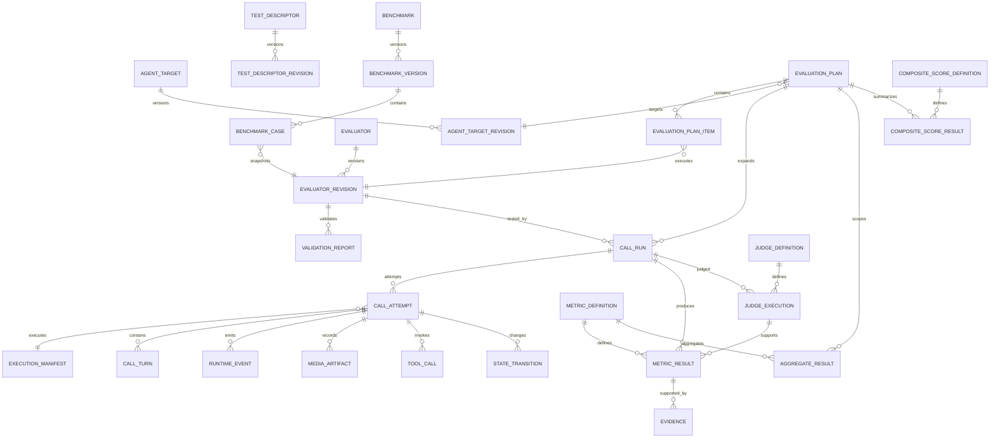

# VoiceEval — Domain Schema v0.3 (Strengthened)

## 1. Design rule

Use relational columns for:

```text
identity
status
timestamps
foreign keys
version numbers
metric keys
enumeration-like values
```

Use JSONB for:

```text
extensible evaluator content
provider-specific metadata
capability maps
judge output
structured configuration
```

PostgreSQL supports indexed JSONB queries, so JSONB is appropriate for extensible scenario/configuration payloads, but frequently queried relational attributes should remain first-class columns. citeturn592638search1

---

## 2. ER model



---

## 3. `agent_target`

```text
id                UUID PK
name              TEXT NOT NULL
provider          TEXT NULL
description       TEXT NULL
created_at        TIMESTAMPTZ NOT NULL
updated_at        TIMESTAMPTZ NOT NULL
```

This is a logical identity, not an executable configuration.

---

## 4. `agent_target_revision`

```text
id                    UUID PK
agent_target_id       UUID FK
revision_no           INT NOT NULL
transport             ENUM(websocket, webrtc)
adapter_name          TEXT NOT NULL
adapter_version       TEXT NOT NULL

endpoint_config       JSONB NOT NULL
capability_snapshot   JSONB NOT NULL

config_hash           TEXT NOT NULL
created_by            UUID/TEXT
created_at            TIMESTAMPTZ NOT NULL
```

Constraints:

```text
UNIQUE(agent_target_id, revision_no)
UNIQUE(agent_target_id, config_hash)
```

`endpoint_config` must contain only non-secret configuration or secret references.

---

## 5. `test_descriptor`

```text
id
name
created_at
updated_at
```

## 6. `test_descriptor_revision`

```text
id
test_descriptor_id FK
revision_no
source_text
normalized_constraints JSONB
generator_model
generator_prompt_hash
created_at
created_by
```

---

## 7. `evaluator`

```text
id
evaluator_key
name
suite_kind            # custom | benchmark
created_at
```

## 8. `evaluator_revision`

```text
id
evaluator_id FK
revision_no
status                # generated | draft | validating | validated | approved | rejected
parent_revision_id FK NULL

schema_version
content JSONB
content_hash

validator_version
created_at
created_by
```

Constraints:

```text
UNIQUE(evaluator_id, revision_no)
UNIQUE(content_hash)
```

Execution must reference an immutable approved revision.

---

## 9. Canonical evaluator document

```yaml
schema_version: evaluator.v1

persona:
  age: 28
  personality: mildly_frustrated
  traits:
    - initially_cooperative
    - interrupt_once

language:
  primary: hinglish
  allowed:
    - en
    - hi
    - hinglish
    - mr
    - gu
  adaptation_rule: follow_caller_pattern

environment:
  noise_profile: low

facts:
  - id: customer_name
    type: string
    value: Rahul
  - id: card_last_four
    type: string
    value: "4821"

initial_state:
  card_blocked: true
  authenticated: false

motive:
  objective: Get the credit card unblocked

  assertions:
    - id: auth_complete
      type: provider_event
      required: true
      expectation:
        event: authentication.completed

    - id: card_unblocked
      type: tool_event
      required: true
      expectation:
        tool: unblock_card
        arguments:
          card_last_four: "4821"

    - id: caller_ack
      type: caller_acknowledgement
      required: true

behaviour:
  allowed_actions:
    - answer_question
    - ask_follow_up
    - correct_misunderstanding
    - interrupt
    - clarify
    - end_call

  recovery:
    max_attempts: 2

stop_conditions:
  natural_success: true
  recovery_exhausted: true
  irrecoverable_objective_failure: true
  conversation_stall_ms: 10000
  wall_clock_timeout_ms: 180000

evaluation_criteria:
  - metric: motive_fulfillment
    required: true
  - metric: semantic_understanding
    required: true
  - metric: response_clarity
    required: true
  - metric: context_retention
    required: true
  - metric: interruption_handling
    required: true
  - metric: language_adaptation
    required: true

randomization:
  policy_version: controlled_variation.v1
```

---

## 10. `validation_report`

```text
id
evaluator_revision_id FK
validator_version
status
blocking_error_count
warning_count
created_at
```

Detailed checks:

```json
{
  "checks": [
    {
      "key": "scenario_validity",
      "status": "pass",
      "severity": "error"
    },
    {
      "key": "motive_validity",
      "status": "pass",
      "severity": "error"
    },
    {
      "key": "observability_validity",
      "status": "warning",
      "severity": "warning",
      "details": "Tool events are optional for this target."
    }
  ]
}
```

---

## 11. `benchmark`

```text
id
benchmark_key
name
created_at
```

## 12. `benchmark_version`

```text
id
benchmark_id FK
version
status               # draft | frozen | retired
manifest JSONB
manifest_hash
created_at
frozen_at
```

## 13. `benchmark_case`

```text
id
benchmark_version_id FK
case_key
evaluator_revision_id FK
sequence_no
```

A frozen version cannot be mutated.

---

## 14. `evaluation_plan`

The plan is the execution contract.

```text
id
kind                          # custom | benchmark
test_descriptor_revision_id FK NULL
benchmark_version_id FK NULL

agent_target_revision_id FK

repeat_count
plan_status                   # draft | ready | queued | running | partial | completed | cancelled

execution_manifest_id FK

created_at
started_at
finished_at
```

Constraints:

```text
kind=benchmark => benchmark_version_id IS NOT NULL
kind=custom    => test_descriptor_revision_id may be NOT NULL

repeat_count >= 1
```

---

## 15. `evaluation_plan_item`

```text
id
evaluation_plan_id FK
evaluator_revision_id FK
sequence_no
enabled
```

Constraint:

```text
UNIQUE(evaluation_plan_id, evaluator_revision_id)
```

---

## 16. `execution_manifest`

This is the strongest reproducibility object.

```text
id
schema_version

target_snapshot JSONB
evaluator_snapshot JSONB
benchmark_snapshot JSONB NULL
caller_snapshot JSONB
metric_snapshot JSONB
judge_snapshot JSONB
aggregation_snapshot JSONB
composite_snapshot JSONB

manifest_hash
created_at
```

The snapshots should contain:

```text
IDs
versions
content hashes
model/version identifiers
prompt hashes
adapter/runtime versions
```

The manifest is immutable.

---

## 17. `call_run` — logical repetition

```text
id
evaluation_plan_id FK
plan_item_id FK
evaluator_revision_id FK
repetition_no
run_seed

status                     # queued | running | completed | infrastructure_failed | cancelled
selected_attempt_id FK NULL

started_at
finished_at
duration_ms
created_at
```

Constraint:

```text
UNIQUE(evaluation_plan_id, plan_item_id, repetition_no)
```

Exactly one logical repetition contributes at most one sample to aggregate statistics.

---

## 18. `call_attempt` — physical execution

```text
id
call_run_id FK
attempt_no

execution_manifest_id FK

status
termination_reason

runner_version
adapter_version
transport_version

trace_id

started_at
finished_at
duration_ms

eligible_for_evaluation BOOLEAN
failure_class NULL

created_at
```

Example:

```text
CallRun #1
  Attempt 1 → RUNNER_CRASH → ineligible
  Attempt 2 → COMPLETED    → eligible
```

Only Attempt 2 contributes metric results.

---

## 19. Failure classes

```text
INFRASTRUCTURE
PROVIDER
TRANSPORT
MEDIA
TIMEOUT
MALFORMED_STREAM
RUNNER_CRASH
CANCELLED
```

Do not use one generic `FAILED` reason if the dashboard needs useful diagnosis.

---

## 20. `call_turn`

```text
id
call_attempt_id FK
sequence_no
speaker                  # caller | agent
start_ms
end_ms

reference_text NULL
observed_text NULL

reference_language_profile JSONB
observed_language_profile JSONB

reference_audio_artifact_id FK NULL
observed_audio_artifact_id FK NULL

transcript_source
transcript_confidence NULL

created_at
```

Critical distinction:

```text
reference_text = what synthetic caller intended
observed_text  = what was actually observed
```

Never overwrite one with the other.

---

## 21. `runtime_event`

```text
id
call_attempt_id FK

sequence_no
event_type
source

monotonic_ms
wall_clock_at
media_timestamp NULL

turn_id FK NULL
provider_event_id NULL

payload JSONB

created_at
```

Constraints:

```text
UNIQUE(call_attempt_id, sequence_no)
```

Provider raw event data should remain inside `payload.provider_raw` when available.

---

## 22. `tool_call`

```text
id
call_attempt_id FK
turn_id FK NULL

ordinal
tool_name
arguments JSONB
result JSONB NULL
status

start_ms
end_ms

source
created_at
```

---

## 23. `state_transition`

```text
id
call_attempt_id FK
sequence_no

state_path
previous_value JSONB
new_value JSONB

trigger_type
trigger_event_id FK NULL

created_at
```

This makes caller-state evolution inspectable.

---

## 24. `media_artifact`

```text
id
call_attempt_id FK
track                  # caller | agent | mixed | provider_capture
representation         # original | analysis | clip

format
codec
sample_rate
channels
duration_ms

clock_domain
object_uri
sha256
size_bytes

created_at
```

---

## 25. `metric_definition`

```text
id
metric_key
version

family
value_type
unit

scale_min NULL
scale_max NULL

required_capabilities JSONB
required_evidence JSONB

implementation_version
aggregation_config JSONB
normalization_config JSONB

created_at
```

---

## 26. `judge_definition`

```text
id
judge_key
version

kind                    # structured_judge | llm_judge
provider
model

prompt_hash
rubric_version
output_schema_version

config JSONB
created_at
```

---

## 27. `judge_execution`

```text
id
call_run_id FK
judge_definition_id FK

input_hash
status
raw_output
parsed_output JSONB

latency_ms
created_at
```

The exact model/prompt/rubric comes from the immutable manifest.

---

## 28. `metric_result`

```text
id
call_run_id FK
call_attempt_id FK

metric_definition_id FK

status
value_numeric NULL
value_boolean NULL
value_text NULL
value_category NULL

unit NULL
scale_min NULL
scale_max NULL

method
measurement_basis JSONB

confidence NULL

judge_execution_id FK NULL
computed_at
```

Add a database constraint ensuring only the appropriate `value_*` field is used for the metric's `value_type`.

---

## 29. `evidence`

```text
id
metric_result_id FK

source_type             # turn | event | tool_call | audio | state_transition
source_id

start_ms NULL
end_ms NULL

quote NULL
rationale

created_at
```

---

## 30. `aggregate_result`

```text
id
evaluation_plan_id FK
scope                     # evaluator | suite | benchmark
evaluator_revision_id FK NULL

metric_definition_id FK

sample_count
coverage_count
availability_ratio

mean
median
min_value
max_value
stddev

p95 NULL
percentile_status        # computed | insufficient_sample | not_applicable

category_counts JSONB

aggregation_version
created_at
```

For n=3, `percentile_status = insufficient_sample`.

---

## 31. `composite_score_definition`

```text
id
version
weights JSONB
normalization JSONB
coverage_policy JSONB
critical_metrics JSONB
created_at
```

---

## 32. `composite_score_result`

```text
id
evaluation_plan_id FK
definition_id FK

score_0_100 NULL
status                    # complete | incomplete | unavailable

coverage_ratio
unavailable_weight

category_scores JSONB
created_at
```

---

## 33. Recommended indexes

```text
agent_target_revision(agent_target_id, revision_no)

evaluator_revision(evaluator_id, revision_no)

evaluation_plan(status)
evaluation_plan_item(evaluation_plan_id, sequence_no)

call_run(evaluation_plan_id, status)
call_run(evaluator_revision_id, repetition_no)

call_attempt(call_run_id, attempt_no)

call_turn(call_attempt_id, sequence_no)
runtime_event(call_attempt_id, sequence_no)

tool_call(call_attempt_id, ordinal)

metric_result(call_run_id, metric_definition_id)
evidence(metric_result_id)

aggregate_result(evaluation_plan_id, metric_definition_id)
```

Use targeted JSONB indexes only for fields that are actually queried often; PostgreSQL's JSONB indexing is powerful but should not replace good relational modeling. citeturn592638search1
